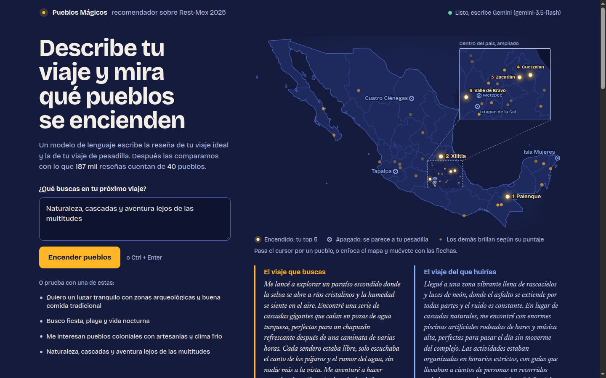
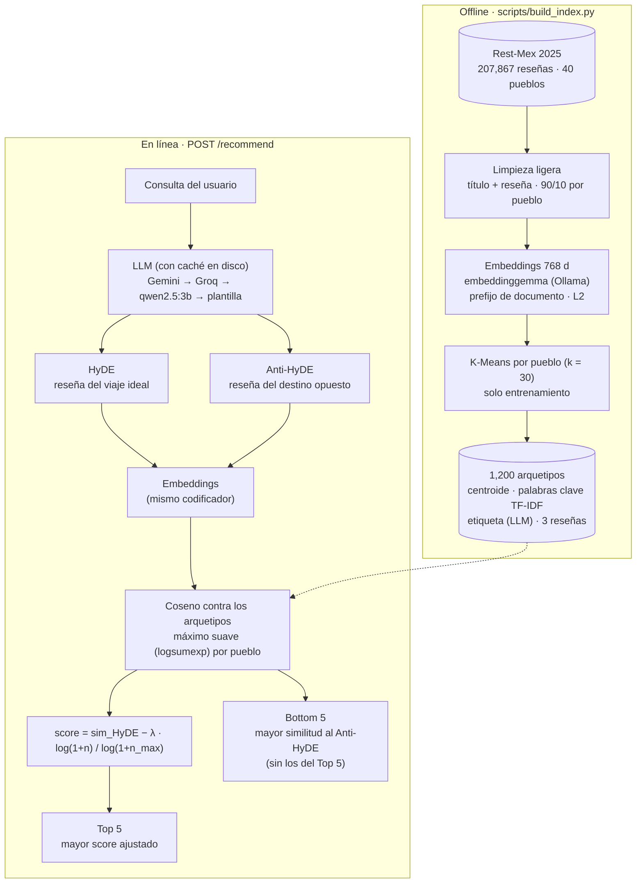
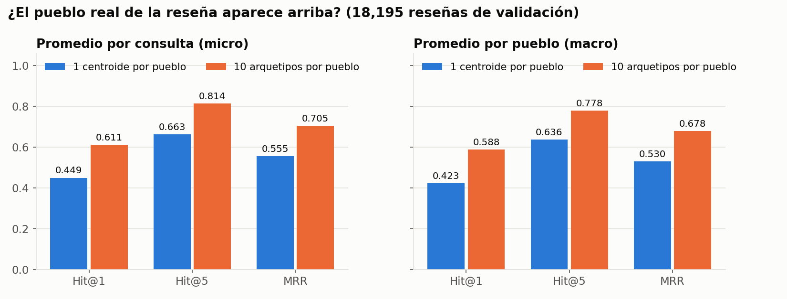
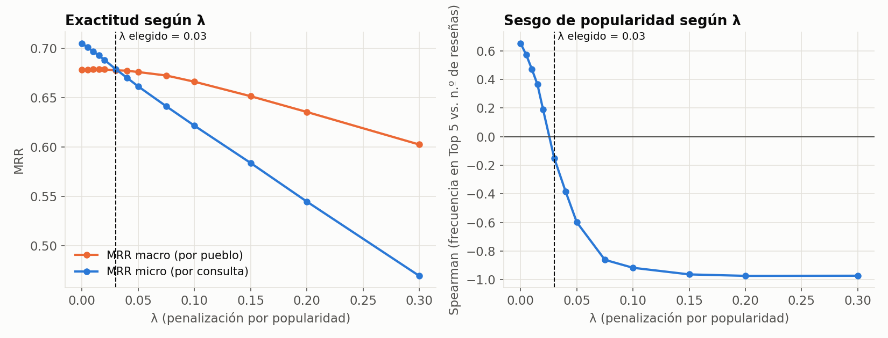
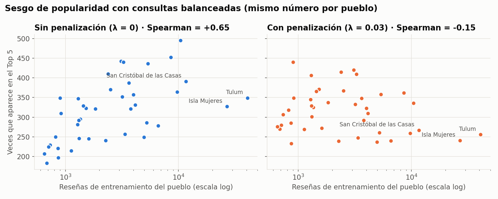
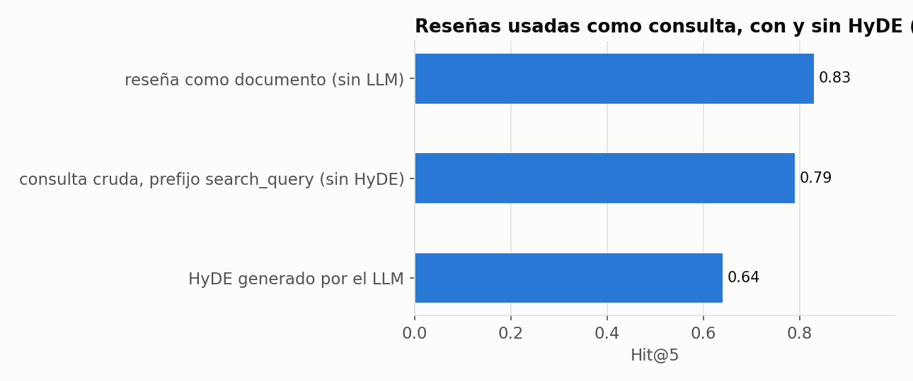

# Recomendador semántico de Pueblos Mágicos (Rest-Mex 2025)

Sistema de recomendación que recibe una descripción en lenguaje natural ("quiero un lugar
tranquilo con zonas arqueológicas…") y devuelve los **5 Pueblos Mágicos que mejor encajan** y
los **5 que más se parecen a lo contrario**, explicando cada resultado con el tema de reseñas
que lo produjo. Incluye una página web interactiva para exposición.



## El problema

El dataset Rest-Mex 2025 contiene ~208 mil reseñas de TripAdvisor sobre 40 Pueblos Mágicos
(hoteles, restaurantes y atractivos). Recomendar un destino a partir de ellas tiene tres retos:

1. **La consulta y las reseñas no se parecen.** Una consulta es corta y abstracta; una reseña
   es larga y concreta. Solución: **HyDE** — un LLM escribe la reseña hipotética del viaje ideal
   y se busca con ella (documento contra documento).
2. **Un pueblo no es una sola cosa.** Tulum es playa, ruinas, buceo y hoteles boutique. Un
   promedio de todas sus reseñas borra esos matices. Solución: **30 arquetipos por pueblo**
   (K-Means sobre sus reseñas) y se toma un máximo suave de sus similitudes.
3. **Los pueblos populares ganan de más (hubness).** Tulum tiene 62 veces más reseñas que
   Tapalpa. Solución: una **penalización logarítmica por popularidad**.

Además, el **Anti-HyDE** (la reseña del viaje "de pesadilla") permite decir qué pueblos
probablemente *no* son para el usuario.

## Pipeline



## Decisiones técnicas

| Decisión | Elección | Por qué |
|---|---|---|
| **Encoder** | `embeddinggemma` vía Ollama (768 d, multilingüe) | Ganó la selección de encoders frente a `nomic-embed-text-v2-moe` (la base anterior), `bge-m3`, `qwen3-embedding:0.6b` y `multilingual-e5-large` (ver [Experimentos](#experimentos)). Corre local en GPU. Está detrás de la interfaz `Encoder`; hay un backend alternativo de `sentence-transformers` (`encoder.backend: sentence_transformers`). |
| **Prefijos del encoder** | Reseñas, HyDE y Anti-HyDE con `title: none \| text: ` | Se compara una reseña hipotética contra reseñas reales: documento contra documento. El prefijo de consulta (`task: search result \| query: `) solo se usa para la consulta cruda en la línea base "sin HyDE" de la evaluación. |
| **Contexto corto** | Truncado explícito a 1,500 caracteres (límite de palabra) | Solo el 0.9 % de las reseñas se trunca; indexar sin truncar no mejoró con ningún encoder de contexto largo. |
| **Limpieza** | `ftfy` (mojibake) + NFKC + espacios; se conservan acentos | ~4,900 reseñas traen texto mal codificado (`Cancún`). Se descartan 184 duplicadas. |
| **k = 30** | K-Means por pueblo, `n_init = 10`, semilla 42, solo entrenamiento | El mejor k del barrido (1–30, k adaptativo y silhouette). Resultado: 1,200 arquetipos; en el pueblo más pequeño (Tapalpa, 653 reseñas) son ~22 reseñas por clúster. |
| **Arquetipo** | Centroide normalizado (L2) | Con vectores unitarios, el producto punto es la similitud coseno. |
| **Explicación** | Palabras clave = TF-IDF medio del clúster − el del resto del pueblo; etiqueta corta generada por el LLM (una llamada por pueblo) | Distingue cada tema *dentro* de su pueblo. |
| **Puntuación** | Máximo suave (logsumexp, τ = 0.01) entre los arquetipos del pueblo | Basta con que *una* faceta del pueblo encaje con la consulta; el máximo suave premia un poco que encajen varias y superó al máximo duro en el barrido. `ranking.aggregation: max` vuelve al máximo. |
| **λ = 0.03** | Calibrado en validación (ver [Resultados](#resultados)) | Es el λ con menor sesgo de popularidad entre los que conservan ≥ 99 % del mejor MRR macro. Con 30 arquetipos el sesgo sin penalización es mayor que con 10 y el λ calibrado se duplicó (era 0.015). |
| **LLM** | `gemini-3.5-flash` → Groq `openai/gpt-oss-120b` → `qwen2.5:3b` → plantilla | Ver [Configuración del LLM](#configuración-del-llm). |
| **Prompt** | JSON con `busca`, `opuesto`, `hyde`, `anti_hyde`; sin reseña de ejemplo | Con un ejemplo completo los modelos lo copiaban. Planear primero las características y sus opuestos hace que el HyDE cubra toda la consulta y que el Anti-HyDE describa **otro tipo de destino** (no "el mismo lugar pero malo"). El Anti-HyDE se escribe como la reseña de un viajero a quien sí le gusta ese lugar, para que coincida por rasgos del destino y no por tono negativo. |

## Instalación

```bash
conda activate bigdata
pip install -r requirements.txt

# Modelos locales (Ollama)
ollama pull embeddinggemma              # embeddings (obligatorio)
ollama pull qwen2.5:3b                  # LLM de respaldo local

# Claves de los LLM en la nube
cp .env.example .env                    # y edita GEMINI_API=... y GROQ_API=...
```

- `GEMINI_API`: clave de [Google AI Studio](https://aistudio.google.com/apikey).
- `GROQ_API`: clave de [Groq](https://console.groq.com/keys).
- `.env` está en `.gitignore`; las claves se cargan con `python-dotenv` y nunca se imprimen ni
  se registran. Sin claves el sistema funciona igual con el modelo local.

Coloca el dataset en `data/raw/Rest-Mex_2025_train.csv` (no se sube al repositorio).
Columnas esperadas: `Title, Review, Polarity, Town, Region, Type`.

## Uso

```bash
make benchmark      # mide textos/s con 500 reseñas y estima el tiempo total
make index-sample   # prueba rápida de punta a punta con 2,000 reseñas (artifacts/sample/)
make index          # dataset completo: embeddings + arquetipos + etiquetas (reanudable)
make evaluate       # métricas → reports/metrics.json y reports/figures/
make report         # protocolo del equipo → reports/evaluation_report.{json,md}
make test           # pytest
make warmup         # precalienta la caché del LLM con las consultas de ejemplo
make serve          # web en http://127.0.0.1:8000
```

- **Construir el índice** (`make index`): calcula los embeddings de las 207,867 reseñas y los
  guarda por bloques en `artifacts/embeddings.npy`; si se interrumpe, al volver a ejecutarlo
  continúa donde se quedó. Con una RTX 2070 los embeddings tardaron 66 min (~70 textos/s con
  `embeddinggemma`) y el K-Means, 3 min. Después agrupa, extrae palabras clave y etiqueta.
- `artifacts/` (embeddings, arquetipos, caché) **no se versiona**: se regenera con `make index`.
- `python scripts/build_index.py --relabel` regenera solo las etiquetas de los arquetipos.
- `RESTMEX_ARTIFACTS=artifacts/sample make serve` levanta la web con el índice de muestra.

### API

| Ruta | Descripción |
|---|---|
| `POST /recommend` `{"query": "...", "lambda": 0.03}` | HyDE, Anti-HyDE, Top 5, Bottom 5 (puntajes, arquetipo ganador, palabras clave, reseña representativa), tiempos por etapa, proveedor del LLM y banderas `cached` / `degraded` / `fallback` |
| `POST /recommend/stream` (mismo cuerpo) | Lo mismo por etapas, en NDJSON: un evento `expansion` con las dos reseñas en cuanto el LLM responde y después `result` (la respuesta de `/recommend`) o `error`. Lo usa la web para mostrar las reseñas mientras se calcula el ranking |
| `GET /towns` | Los 40 pueblos con estado, número de reseñas, coordenadas (`lat`, `lon`) y etiquetas de sus arquetipos, para el mapa |
| `GET /health` | Estado de Ollama, cadena de LLM e índice |
| `GET /docs` | Documentación interactiva (OpenAPI) |

`/recommend` incluye además `towns`: los 40 pueblos con `sim_hyde`, `sim_anti`, `penalty`,
`score`, etiquetas de arquetipo y `group` (`top`, `bottom` o `null`). Es un campo añadido; el
resto de la respuesta no cambió.

### La web

Una sola página (HTML, CSS y JS servidos por FastAPI, sin paso de compilación ni CDN: funciona
sin internet). El país se ve de noche y cada pueblo es una luz:

- **Mapa:** al llegar el resultado se encienden los 5 del top, se apagan los 5 del bottom y
  los demás brillan según su puntaje. El centro del país va en un recuadro ampliado porque ahí
  hay 17 pueblos muy juntos. Con el cursor o el teclado (flechas dentro del mapa) se ve la
  etiqueta del arquetipo de cada pueblo; Enter lleva a su tarjeta.
- **Reseñas:** las dos que escribe el LLM (el viaje que buscas y el viaje del que huirías) se
  van escribiendo en pantalla mientras se calcula el ranking.
- **Afinidad contra rechazo:** cada pueblo es un punto con x = parecido con el viaje ideal e
  y = parecido con la pesadilla; debajo hay una tabla con los 40 valores.
- **Tarjetas:** puntaje desglosado (parecido − penalización) sobre una tira con los 40
  pueblos, palabras clave y la reseña representativa desplegable.
- **Estados:** el indicador de arriba a la derecha avisa si Ollama está apagado o falta el
  índice. Si responde un modelo de respaldo o se usa la plantilla, aparece un aviso junto al
  botón, y bajo las reseñas se lee quién las escribió y si salieron de la caché.
- **Accesibilidad:** contraste AA, foco visible, región `aria-live` durante la carga y
  `prefers-reduced-motion` (sin animaciones, las reseñas aparecen completas).

Recursos en `src/restmex/app/static/`: `data/mexico.geojson` (Natural Earth, dominio público,
simplificado con `scripts/build_map_assets.py`) y `vendor/fonts/` (Bricolage Grotesque y
Newsreader, licencia OFL). Las coordenadas de los pueblos están en `src/restmex/geo.py`,
cotejadas contra OpenStreetMap.

## Configuración del LLM

El LLM se usa en dos puntos: generar HyDE / Anti-HyDE en cada consulta y etiquetar los
arquetipos al construir el índice. Los **embeddings siempre** se calculan con
`embeddinggemma` en Ollama.

Cadenas de respaldo (`src/restmex/llm.py`, configurables en `config.yaml`):

```
Web y etiquetas (llm.chain):   gemini-3.5-flash → Groq (openai/gpt-oss-120b) → qwen2.5:3b → plantilla
Evaluación (llm.eval_chain):   Groq (openai/gpt-oss-120b) → qwen2.5:3b → plantilla
```

**Por qué esta cadena.** Gemini Flash da las reseñas hipotéticas más naturales, pero la capa
gratuita tiene cuota diaria limitada; Groq responde en ~2 s con un modelo grande y cuota más
amplia; `qwen2.5:3b` es local y funciona sin internet, aunque con textos más pobres; la
plantilla de antónimos garantiza que la demo nunca se rompa. `gemini-3.8-flash` (el Flash más
reciente) se descartó: en la capa gratuita solo permite 20 solicitudes por día y devolvía
errores 503/504 con frecuencia. La evaluación usa Groq para no gastar la cuota de Gemini.

| Clave de `config.yaml` | Valor | Qué hace |
|---|---|---|
| `llm.chain` | `[gemini, groq, ollama]` | Orden de proveedores para la web y las etiquetas |
| `llm.eval_chain` | `[groq, ollama]` | Orden para la evaluación con HyDE |
| `llm.gemini_model` / `llm.gemini_rpm` | `gemini-3.5-flash` / `10` | Modelo y solicitudes por minuto |
| `llm.groq_model` / `llm.groq_rpm` | `openai/gpt-oss-120b` / `30` | Modelo (API compatible con OpenAI) y solicitudes por minuto |
| `llm.ollama_model` | `qwen2.5:3b` | Respaldo local (se puede cambiar por `qwen2.5:7b`) |
| `llm.retries` | `1` | Reintentos por proveedor ante un JSON mal formado |
| `llm.cooldown` | `300` | Segundos que se omite un proveedor después de un error |
| `llm.cache` / `llm.cache_dir` | `true` / `artifacts/llm_cache` | Caché en disco de respuestas |

Control de cuotas y fallos:

- **Límite de tasa por proveedor** (ventana de 60 s). En procesos por lotes (etiquetas,
  evaluación) se espera el cupo; en la web se pasa al siguiente eslabón para no hacer esperar.
- **429 / 503 pasajeros:** backoff y reintento (respeta el `retry-after` del servicio).
- **Cuota diaria agotada:** el proveedor queda marcado como agotado durante el resto de la
  sesión y no se vuelve a intentar.
- **JSON mal formado dos veces** o cualquier otro error: siguiente eslabón.
- **Nada responde:** la consulta original se usa como HyDE y una plantilla de antónimos como
  Anti-HyDE. La interfaz lo avisa.
- **Caché en disco:** la clave es el hash de proveedor + modelo + prompt. Repetir una consulta
  (o volver a etiquetar) no gasta cuota y responde al instante.

Gemini se llama con el SDK oficial `google-genai` y salida JSON estructurada
(`response_mime_type="application/json"`); Groq, con `response_format={"type": "json_object"}`.
La respuesta de la API (`llm_provider`, `llm_model`, `cached`, `degraded`, `fallback`) y la
interfaz web indican siempre qué proveedor respondió.

## Experimentos

La configuración actual salió de cuatro rondas de experimentos sobre la versión inicial
(`nomic-embed-text-v2-moe`, k = 10, máximo, λ = 0.015). El registro completo está en
[`reports/experiments.md`](reports/experiments.md) y el informe con tablas, intervalos de
confianza y limitaciones en [`docs/informe/informe.pdf`](docs/informe/informe.pdf).

| Ronda | Qué se probó | Conclusión |
|---|---|---|
| Encoder | nomic, bge-m3, qwen3-embedding 0.6b, embeddinggemma y multilingual-e5-large en una muestra de 1,500 reseñas por pueblo | **embeddinggemma**: MRR macro en validación 0.635 frente a 0.618 de nomic y mejor gold; con HyDE todos empatan |
| Contexto largo | bge-m3, qwen3 y embeddinggemma sin truncar las reseñas | Sin efecto medible: se queda `max_chars: 1500` |
| Arquetipos | 61 combinaciones de k (1–30, adaptativo, silhouette) y agregación (máximo, media de 2, logsumexp) | **k = 30 con logsumexp (τ = 0.01)**: +0.048 de MRR macro en la mitad de prueba del holdout, IC95 [+0.012, +0.084] |
| Calidad de reseñas | 14 filtros y pesos (longitud, genéricas, idioma, duplicados, tipo) con 4 semillas del K-Means | Ninguno supera el ruido de semilla (±0.017): **sin filtros** |
| Verificación | embeddinggemma + k = 30 + logsumexp sobre el corpus completo | MRR macro 0.678 frente a 0.665 de nomic con k = 30: **se adopta** |

## Resultados

Evaluación sobre el 10 % de validación (`make evaluate`, detalle en `reports/metrics.json`).
**Consulta = una reseña de validación con polaridad 4–5** (18,195 reseñas); **acierto = el
pueblo real de la reseña aparece en el Top-k** entre los 40. Los arquetipos se construyeron
solo con el 90 % de entrenamiento (187,080 reseñas). "Macro" promedia por pueblo (todos pesan
igual); "micro" promedia por consulta (dominan Tulum e Isla Mujeres).

### (a) Un centroide por pueblo vs. 30 arquetipos, y (b) con y sin penalización

| Variante | Hit@1 | Hit@5 | MRR | Hit@1 macro | Hit@5 macro | MRR macro | Sesgo (Spearman) |
|---|---|---|---|---|---|---|---|
| 1 centroide por pueblo, sin penalización | 0.449 | 0.663 | 0.555 | 0.423 | 0.637 | 0.530 | −0.05 |
| 30 arquetipos, sin penalización | **0.611** | **0.814** | **0.705** | **0.588** | 0.778 | **0.678** | +0.65 |
| **30 arquetipos, λ = 0.03 (configuración final)** | 0.585 | 0.784 | 0.679 | 0.586 | **0.782** | 0.678 | **−0.15** |
| *Base anterior: nomic, 10 arquetipos, λ = 0.015* | *0.534* | *0.740* | *0.633* | *0.537* | *0.735* | *0.631* | *−0.08* |

- **Los arquetipos importan:** frente a un solo centroide, Hit@1 sube de 0.45 a 0.61 y Hit@5
  de 0.66 a 0.81. Al azar, Hit@5 sería 0.125.
- **El costo de los arquetipos es el sesgo de popularidad:** agregar 30 arquetipos favorece a
  los pueblos con más reseñas (sus clústeres cubren más temas), más que con 10.
- **La penalización lo corrige casi gratis:** con λ = 0.03 el MRR macro no cambia (0.678) y el
  sesgo pasa de +0.65 a −0.15. El precio es −2.7 puntos de Hit@1 micro, justamente porque las
  consultas de validación vienen en su mayoría de los pueblos populares.
- **Frente a la base anterior** el sistema gana +5.0 puntos de Hit@1, +4.4 de Hit@5 y +0.046
  de MRR macro (ver [Experimentos](#experimentos)).



### Sesgo de popularidad y calibración de λ

Correlación de Spearman entre **cuántas veces aparece un pueblo en el Top 5** y **su número
de reseñas**. Se mide con consultas balanceadas (el mismo número por pueblo): así, un sistema
sin sesgo mostraría a todos los pueblos por igual y la correlación sería ~0.

| | Antes (λ = 0) | Después (λ = 0.03) |
|---|---|---|
| Spearman, consultas balanceadas (2,520 consultas) | **+0.65** | **−0.15** |
| Spearman, todas las consultas de validación | +0.89 | +0.69 |

Con todas las consultas la correlación sigue siendo alta porque la mayoría de las reseñas de
validación *son* de pueblos populares (su pueblo correcto es popular); por eso la medida justa
es la balanceada.

**Criterio de calibración:** entre los λ cuyo MRR macro queda a menos de 1 % del mejor, se
elige el de menor |Spearman|. La rejilla es gruesa en esa zona: con λ = 0.02 el sesgo es +0.19
y con 0.03, −0.15, así que queda algo sobrecorregido; con λ ≥ 0.05 se invierte del todo (−0.60
o peor: se castiga de más a los pueblos populares) y la exactitud empieza a caer.




### (c) Con y sin HyDE (muestra de 100 reseñas)

| Variante | Hit@1 | Hit@5 | MRR |
|---|---|---|---|
| Reseña codificada como documento (referencia, sin LLM) | 0.64 | 0.83 | 0.727 |
| **Sin HyDE:** reseña como consulta cruda (prefijo de consulta) | 0.61 | 0.79 | 0.691 |
| **Con HyDE:** reseña hipotética generada por el LLM (prefijo de documento) | 0.39 | 0.64 | 0.513 |



Las 100 reseñas hipotéticas las generó Groq (`openai/gpt-oss-120b`); no hizo falta el respaldo.

**En esta prueba HyDE empeora el resultado** (Hit@5 de 0.79 a 0.64), y es lo esperable: la "consulta" ya es una
reseña real, con nombres propios y detalles del pueblo ("el cenote Zací", "la pirámide del Sol"), y el prompt
prohíbe al LLM escribir nombres propios, así que el HyDE la convierte en una reseña genérica y borra
justo las pistas que identifican al pueblo. Con n = 100 el margen de error es de unos ±10 puntos.

HyDE está pensado para el caso contrario, el de la web: consultas cortas y abstractas ("algo tranquilo
con ruinas") que no se parecen a ninguna reseña. Con las 40 consultas cortas del gold del equipo
(sección siguiente) la consulta cruda también queda por delante del HyDE, así que es la pieza
con más margen de mejora.

### Score con el protocolo del equipo

`make report` (detalle en [`docs/evaluation_report.md`](docs/evaluation_report.md)): gold de 40
consultas con el pipeline completo de la web, holdout enmascarado de 600 reseñas, ablación,
robustez, casos adversariales y determinismo.

| Criterio de la rúbrica | Sistema final | Umbral | Estado | Base anterior |
|---|---|---|---|---|
| Precision@5 (gold, 11 consultas con ≥ 5 relevantes) | 0.764 | 0.7 | ✅ | 0.691 |
| Hit@1 (gold) | 0.725 | 0.8 | ❌ | 0.650 |
| Contrato 5 + 5 | 1.000 | 1.0 | ✅ | 1.000 |
| Determinismo (con caché de LLM) | 1.000 | 1.0 | ✅ | 1.000 |
| Latencia p95 en caliente (s) | 0.053 | 3.0 | ✅ | 0.030 |
| Latencia p95 en frío (s) | sin medir (todo el gold estaba en caché) | 3.0 | — | 2.674 |

| | Hit@1 | Hit@5 | MRR | nDCG@5 | Error en bottom 5 |
|---|---|---|---|---|---|
| Gold, sistema final | 0.725 | 0.925 | 0.819 | 0.720 | 0.100 |
| Gold, base anterior | 0.650 | 0.875 | 0.767 | 0.631 | 0.125 |
| Gold, consulta cruda sin HyDE (ablación) | 0.850 | 0.975 | 0.912 | 0.784 | 0.100 |
| Gold, popularidad | 0.175 | 0.375 | 0.278 | 0.162 | 0.300 |
| Holdout, reseña como documento (n = 600) | 0.470 | 0.707 | 0.581 | — | 0.003 |
| Holdout, HyDE + Anti-HyDE (n = 200) | 0.320 | 0.585 | 0.437 | — | 0.095 |

- Se cumplen cuatro de los cinco criterios medidos; falta el umbral de Hit@1 del gold.
- 136 de las 200 expansiones HyDE del holdout las escribió `qwen2.5:3b` (la cuota diaria de
  Groq se agotó), así que esa fila es conservadora.
- Robustez: Jaccard medio del Top 5 de 0.546 ante paráfrasis de la consulta (120 pares). Casos
  adversariales: 0.800 (fallan una consulta fuera de vocabulario y una exclusión de pueblo).

### Consultas de prueba

Resultados reales de la web (λ = 0.03, HyDE generado por Groq `openai/gpt-oss-120b`, desde la caché):

| Consulta | Top 5 | Bottom 5 |
|---|---|---|
| Quiero un lugar tranquilo con zonas arqueológicas y buena comida tradicional | Tlaquepaque, Palenque, Tepotzotlán, Coatepec, Tepoztlán | Isla Mujeres, Sayulita, Pátzcuaro, Ixtapan de la Sal, Todos Santos |
| Busco fiesta, playa y vida nocturna | Tulum, Sayulita, Isla Mujeres, Todos Santos, Loreto | Tequisquiapan, Tapalpa, Ajijic, Tlaquepaque, Huasca de Ocampo |
| Me interesan pueblos coloniales con artesanías y clima frío | Huasca de Ocampo, Atlixco, Coatepec, Tepoztlán, Pátzcuaro | Isla Mujeres, Sayulita, Tulum, Todos Santos, Cuatro Ciénegas |
| Naturaleza, cascadas y aventura lejos de las multitudes | Palenque, Xilitla, Zacatlán, Cuetzalan, Valle de Bravo | Isla Mujeres, Ixtapan de la Sal, Cuatro Ciénegas, Metepec, Tapalpa |

- **Lo que sale bien:** las playas de Tulum / Sayulita / Isla Mujeres / Todos Santos / Loreto
  (los cinco son de costa; la base anterior metía Cuatro Ciénegas), las cascadas de Palenque,
  Xilitla, Zacatlán y Cuetzalan, y los Bottom 5 de "playa" (pueblos de sierra y de interior) y
  de "colonial y frío" (playa y desierto), que son justo los opuestos.
- **Lo que no:** en la primera consulta gana Tlaquepaque por un arquetipo de restaurantes (la
  "buena comida tradicional" pesa más que las zonas arqueológicas) y Teotihuacán no llega al
  Top 5; Tapalpa aparece en el Bottom 5 de "naturaleza" aunque es un pueblo de sierra.

### Limitaciones

- La evaluación mide si se recupera el pueblo de una reseña, no la satisfacción de un viajero
  real; muchas reseñas son genéricas ("excelente hotel") y no identifican a su pueblo.
- El dataset no trae fotos, precios ni clima: "clima frío" solo se infiere de lo que cuentan
  las reseñas.
- En todo lo que se pudo medir, HyDE resta exactitud frente a la consulta cruda, y el sistema
  no interpreta exclusiones ("sin playa"). Más limitaciones en el informe.

## Checklist para el día de la exposición

1. **Ollama activo:** `ollama serve` (o el servicio del sistema) y `ollama list` debe mostrar
   `embeddinggemma` y `qwen2.5:3b`. Sin Ollama no hay embeddings y la web no puede
   responder.
2. **Entorno:** `conda activate bigdata`, y `.env` con `GEMINI_API` y `GROQ_API`.
3. **Índice presente:** `ls artifacts/archetypes.npy` (si falta: `make index`).
4. **Precalentar:** `make warmup` deja en caché las 4 consultas de ejemplo; en la web
   responden al instante y sin gastar cuota.
5. **Levantar la web:** `make serve` y abrir <http://127.0.0.1:8000>. El indicador de arriba
   a la derecha debe decir "Listo".
6. **Probar una consulta nueva** para confirmar qué proveedor responde (se lee bajo las
   reseñas: "Escritas por…").

**Si no hay internet:** las consultas de ejemplo salen de la caché (idénticas). Una consulta
nueva pasa a `qwen2.5:3b` local: tarda 5–10 s y la interfaz avisa que respondió el modelo de
respaldo; los resultados siguen siendo razonables, con textos menos pulidos. Si tampoco
respondiera Ollama para generar texto, se usa la plantilla y la interfaz lo indica.

**Si se agota la cuota de Gemini** (capa gratuita): la cadena pasa sola a Groq; no hay que
tocar nada.

## Estructura

```
config.yaml                 # configuración base: rutas, encoder, k, agregación, cadena de LLM, λ
configs/                    # un YAML por experimento (heredan con `extends: config.yaml`)
scripts/build_index.py      # offline: datos → embeddings → arquetipos → etiquetas
scripts/evaluate.py         # métricas de validación y figuras
scripts/evaluate_report.py  # reporte con el protocolo del equipo (gold, holdout enmascarado, robustez)
scripts/compare_encoders.py # tabla comparativa de encoders con bootstrap pareado
scripts/sweep_archetypes.py # barrido de k y agregación
scripts/sweep_quality.py    # diagnóstico y filtros de calidad de reseñas
scripts/warmup.py           # precalienta la caché del LLM
scripts/build_map_assets.py # regenera el mapa de la web desde Natural Earth
src/restmex/
  config.py                 # configuración tipada
  data.py                   # ingesta, limpieza, partición 90/10
  encoders.py               # interfaz Encoder (Ollama / sentence-transformers) y caché reanudable
  archetypes.py             # K-Means por pueblo, palabras clave, etiquetas
  llm.py                    # GeminiClient, GroqClient, cadena, cuotas y caché
  ollama_client.py          # cliente HTTP de Ollama
  prompts.py                # prompts de HyDE / Anti-HyDE y etiquetas; plantilla de antónimos
  query_expansion.py        # HyDE y Anti-HyDE con validación y fallback
  retrieval.py              # índice de arquetipos y similitud por pueblo
  aggregation.py            # agregaciones por pueblo (máximo, media de 2, logsumexp)
  ranking.py                # penalización por popularidad, Top 5 y Bottom 5
  recommender.py            # orquestación en línea y tiempos por etapa
  geo.py                    # coordenadas de los 40 pueblos (solo para el mapa)
  evaluate.py, plots.py     # métricas y gráficas
  report.py, bootstrap.py   # protocolo del equipo y bootstrap pareado
  review_quality.py         # filtros y pesos de calidad (apagados por defecto)
  validation.py             # validación mínima de la consulta
  app/                      # FastAPI + frontend (HTML, CSS y JS sin paso de build; mapa y fuentes en static/)
tests/                      # pytest con Ollama, Gemini y Groq simulados
eval/                       # gold y banco de consultas del equipo, row_id del holdout
reports/                    # metrics.json, evaluation_report.json, figuras y experiments.md
reports/exp/                # resultados de cada experimento
docs/                       # evaluation_report.md e informe/ (LaTeX y PDF)
notebooks/01_eda_restmex.ipynb
```
