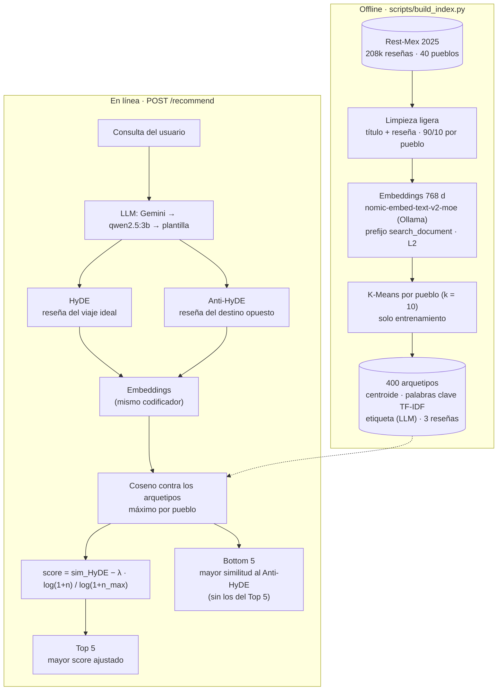

# Recomendador semántico de Pueblos Mágicos (Rest-Mex 2025)

Sistema de recomendación que recibe una descripción en lenguaje natural ("quiero un lugar
tranquilo con zonas arqueológicas…") y devuelve los **5 Pueblos Mágicos que mejor encajan** y
los **5 que más se parecen a lo contrario**, explicando cada resultado con el tema de reseñas
que lo produjo. Incluye una página web interactiva para exposición.


## El problema

El dataset Rest-Mex 2025 contiene ~208 mil reseñas de TripAdvisor sobre 40 Pueblos Mágicos
(hoteles, restaurantes y atractivos). Recomendar un destino a partir de ellas tiene tres retos:

1. **La consulta y las reseñas no se parecen.** Una consulta es corta y abstracta; una reseña
   es larga y concreta. Solución: **HyDE** — un LLM escribe la reseña hipotética del viaje ideal
   y se busca con ella (documento contra documento).
2. **Un pueblo no es una sola cosa.** Tulum es playa, ruinas, fiesta y hoteles boutique. Un
   promedio de todas sus reseñas borra esos matices. Solución: **10 arquetipos por pueblo**
   (K-Means sobre sus reseñas) y se toma el arquetipo más parecido.
3. **Los pueblos populares ganan siempre (hubness).** Tulum tiene 62 veces más reseñas que
   Tapalpa. Solución: una **penalización logarítmica por popularidad**.

Además, el **Anti-HyDE** (la reseña del viaje "de pesadilla") permite decir qué pueblos
probablemente *no* son para el usuario.

## Pipeline



## Decisiones técnicas

| Decisión | Elección | Por qué |
|---|---|---|
| **Encoder** | `nomic-embed-text-v2-moe` vía Ollama (768 d, multilingüe) | Corre local en GPU (~110 textos/s en una RTX 2070 a plena potencia); las reseñas están en español. Está detrás de la interfaz `Encoder`; hay un backend alternativo de `sentence-transformers` (`encoder.backend: sentence_transformers`), p. ej. `paraphrase-multilingual-mpnet-base-v2` o TourBERT (entrenado en inglés: solo para comparar). |
| **Prefijos de nomic** | Reseñas, HyDE y Anti-HyDE con `search_document: ` | Se compara una reseña hipotética contra reseñas reales: documento contra documento. `search_query: ` solo se usa para la consulta cruda en la línea base "sin HyDE" de la evaluación. |
| **Contexto corto** | Truncado explícito a 1,500 caracteres (límite de palabra) | El modelo admite ~512 tokens; menos del 1 % de las reseñas se trunca. |
| **Limpieza** | `ftfy` (mojibake) + NFKC + espacios; se conservan acentos | ~4,900 reseñas traen texto mal codificado (`Cancún`). Se descartan 184 duplicadas. |
| **k = 10** | K-Means por pueblo, `n_init = 10`, semilla 42 | El pueblo más pequeño tiene 652 reseñas de entrenamiento (≥ 65 por clúster). |
| **Arquetipo** | Centroide normalizado (L2) | Con vectores unitarios, el producto punto es la similitud coseno. |
| **Explicación** | Palabras clave = TF-IDF medio del clúster − el del resto del pueblo; etiqueta corta generada por el LLM | Distingue cada tema *dentro* de su pueblo. |
| **Puntuación** | Máximo entre los arquetipos del pueblo | Basta con que *una* faceta del pueblo encaje con la consulta. |
| **λ** | Calibrado en validación (ver [Resultados](#resultados)) | Se elige el λ con menor sesgo de popularidad entre los que conservan ≥ 99 % del mejor MRR macro. |
| **LLM** | Gemini Flash → `qwen2.5:3b` → plantilla | Ver [Configuración del LLM](#configuración-del-llm). |
| **Prompt** | JSON con `busca`, `opuesto`, `hyde`, `anti_hyde`; sin reseña de ejemplo | Con un ejemplo completo los modelos lo copiaban. Planear primero las características y sus opuestos hace que el HyDE cubra toda la consulta y que el Anti-HyDE describa **otro tipo de destino** (no "el mismo lugar pero malo"). El Anti-HyDE se escribe como la reseña de un viajero a quien sí le gusta ese lugar, para que coincida por rasgos del destino y no por tono negativo. |

## Instalación

```bash
conda activate bigdata
pip install -r requirements.txt

# Modelos locales
ollama pull nomic-embed-text-v2-moe     # embeddings (obligatorio)
ollama pull qwen2.5:3b                  # LLM de respaldo

# Clave de Gemini (opcional pero recomendada)
cp .env.example .env                    # y edita GEMINI_API=...
```

Coloca el dataset en `data/raw/Rest-Mex_2025_train.csv` (no se sube al repositorio).
Columnas esperadas: `Title, Review, Polarity, Town, Region, Type`.

## Uso

```bash
make benchmark      # mide textos/s con 500 reseñas y estima el tiempo total
make index-sample   # prueba rápida de punta a punta con 2,000 reseñas (artifacts/sample/)
make index          # dataset completo: embeddings + arquetipos (reanudable)
make evaluate       # métricas → reports/metrics.json y reports/figures/
make test           # pytest
make serve          # web en http://127.0.0.1:8000
```

- `artifacts/` (embeddings, arquetipos) **no se versiona**: se regenera con `make index`.
  Los embeddings se guardan por bloques; si el proceso se interrumpe, al volver a ejecutarlo
  continúa donde se quedó.
- `python scripts/build_index.py --relabel` regenera solo las etiquetas de los arquetipos.
- `RESTMEX_ARTIFACTS=artifacts/sample make serve` levanta la web con el índice de muestra.

### API

| Ruta | Descripción |
|---|---|
| `POST /recommend` `{"query": "...", "lambda": 0.05}` | HyDE, Anti-HyDE, Top 5, Bottom 5 (puntajes, arquetipo ganador, palabras clave, reseña representativa), tiempos por etapa, proveedor del LLM y banderas `degraded` / `fallback` |
| `GET /health` | Estado de Ollama, cadena de LLM e índice |
| `GET /docs` | Documentación interactiva (OpenAPI) |

## Configuración del LLM

El LLM se usa en dos puntos: generar HyDE / Anti-HyDE en cada consulta y etiquetar los
arquetipos al construir el índice. Los **embeddings siempre** se calculan con
`nomic-embed-text-v2-moe` en Ollama.

Cadena de respaldo (`src/restmex/llm.py`):

```
Gemini (gemini_model → gemini_fallback_models) → Ollama (ollama_model) → plantilla de antónimos
```

1. Copia `.env.example` como `.env` y pon tu clave de [Google AI Studio](https://aistudio.google.com/apikey):
   `GEMINI_API=tu_clave`. El archivo `.env` está en `.gitignore`; la clave se carga con
   `python-dotenv` y nunca se imprime ni se registra.
2. Ajusta `config.yaml`:

   | Clave | Valor | Qué hace |
   |---|---|---|
   | `llm.provider` | `gemini` | `gemini` usa la cadena completa; `ollama` usa solo el modelo local |
   | `llm.gemini_model` | `gemini-3.8-flash` | Modelo principal (el Flash más reciente disponible con la clave) |
   | `llm.gemini_fallback_models` | `[gemini-3.5-flash]` | Otros modelos de Gemini que se prueban si el principal falla |
   | `llm.gemini_thinking_level` | `low` | Razonamiento mínimo para bajar la latencia |
   | `llm.gemini_timeout` | `15` | Segundos antes de pasar al siguiente eslabón |
   | `llm.ollama_model` | `qwen2.5:3b` | Respaldo local (se puede cambiar por `qwen2.5:7b`) |
   | `llm.retries` | `1` | Reintentos por proveedor ante un JSON mal formado |
   | `llm.cooldown` | `300` | Segundos que se omite un proveedor después de fallar |

Gemini se llama con el SDK oficial `google-genai` y salida JSON estructurada
(`response_mime_type="application/json"`). Comportamiento ante fallos:

- **503 (alta demanda):** un reintento rápido; si persiste, siguiente eslabón.
- **429 (cuota):** el proveedor se omite durante el tiempo que indica la API ("retry in…").
  En la capa gratuita, los modelos Flash más nuevos tienen un límite de **20 solicitudes por
  día**; al agotarse, la cadena sigue con el siguiente modelo sin costo de latencia.
- **JSON mal formado dos veces:** siguiente eslabón.
- **Nada responde:** la consulta original se usa como HyDE y una plantilla de antónimos como
  Anti-HyDE. La interfaz lo avisa.

La respuesta de la API (`llm_provider`, `llm_model`, `degraded`, `fallback`) y la interfaz web
indican siempre qué proveedor respondió.

## Estructura

```
config.yaml                 # rutas, encoder, k, LLM, λ
scripts/build_index.py      # offline: datos → embeddings → arquetipos
scripts/evaluate.py         # métricas y figuras
src/restmex/
  config.py                 # configuración tipada
  data.py                   # ingesta, limpieza, partición 90/10
  encoders.py               # interfaz Encoder (Ollama / sentence-transformers) y caché reanudable
  archetypes.py             # K-Means por pueblo, palabras clave, etiquetas
  llm.py                    # GeminiClient, cadena de proveedores, cuotas
  ollama_client.py          # cliente HTTP de Ollama
  prompts.py                # prompts de HyDE / Anti-HyDE y etiquetas; plantilla de antónimos
  query_expansion.py        # HyDE y Anti-HyDE con validación y fallback
  retrieval.py              # índice de arquetipos y máximo por pueblo
  ranking.py                # penalización por popularidad, Top 5 y Bottom 5
  recommender.py            # orquestación en línea y tiempos por etapa
  evaluate.py, plots.py     # métricas y gráficas
  app/                      # FastAPI + frontend (HTML, CSS y JS sin paso de build)
tests/                      # pytest con Ollama y Gemini simulados
notebooks/01_eda_restmex.ipynb
```
