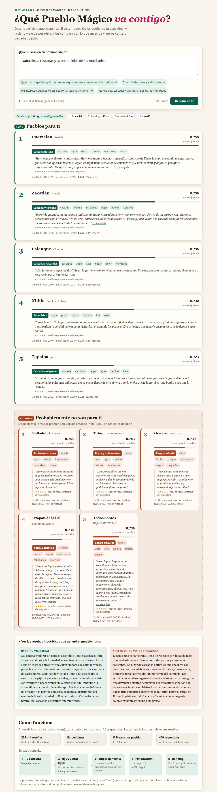
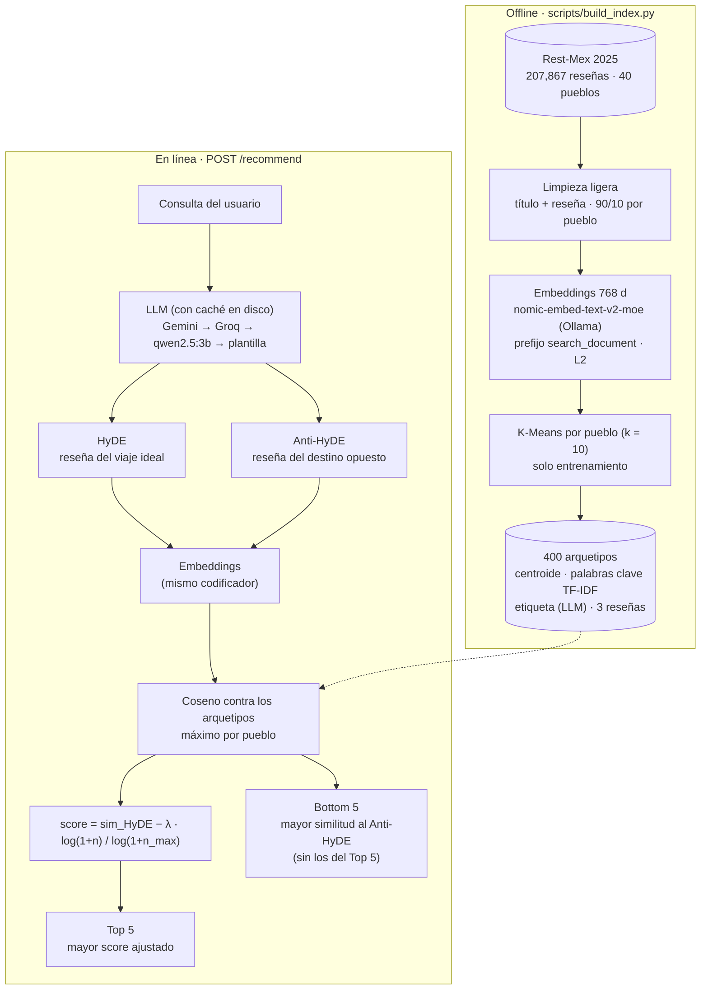
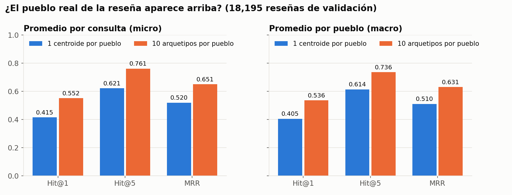
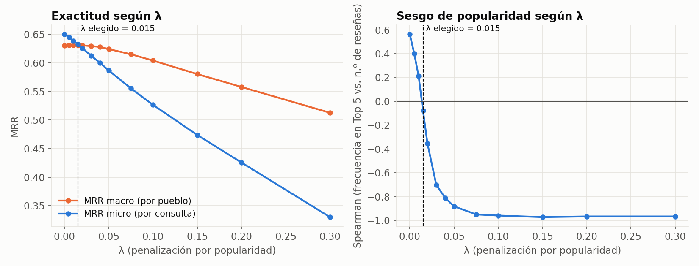
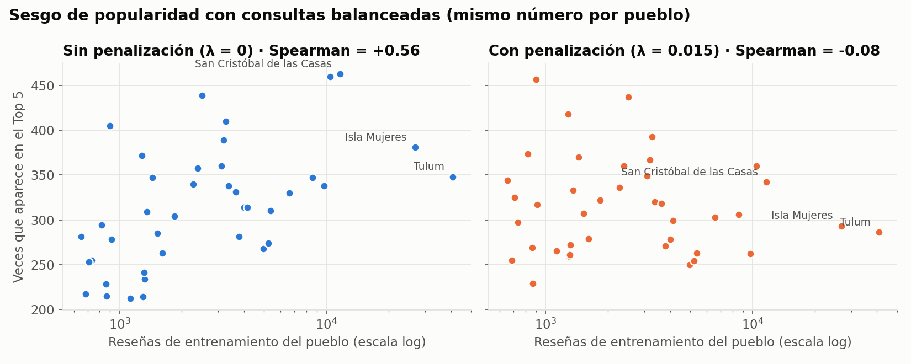
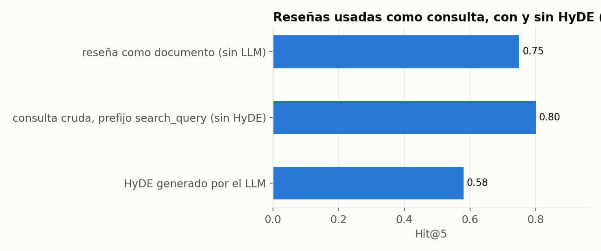

# Recomendador semántico de Pueblos Mágicos (Rest-Mex 2025)

Sistema de recomendación que recibe una descripción en lenguaje natural ("quiero un lugar
tranquilo con zonas arqueológicas…") y devuelve los **5 Pueblos Mágicos que mejor encajan** y
los **5 que más se parecen a lo contrario**, explicando cada resultado con el tema de reseñas
que lo produjo. Incluye una página web interactiva para exposición.



## El problema

El dataset Rest-Mex 2025 contiene ~208 mil reseñas de TripAdvisor sobre 40 Pueblos Mágicos
(hoteles, restaurantes y atractivos). Recomendar un destino a partir de ellas tiene tres retos:

1. **La consulta y las reseñas no se parecen.** Una consulta es corta y abstracta; una reseña
   es larga y concreta. Solución: **HyDE** — un LLM escribe la reseña hipotética del viaje ideal
   y se busca con ella (documento contra documento).
2. **Un pueblo no es una sola cosa.** Tulum es playa, ruinas, buceo y hoteles boutique. Un
   promedio de todas sus reseñas borra esos matices. Solución: **10 arquetipos por pueblo**
   (K-Means sobre sus reseñas) y se toma el arquetipo más parecido.
3. **Los pueblos populares ganan de más (hubness).** Tulum tiene 62 veces más reseñas que
   Tapalpa. Solución: una **penalización logarítmica por popularidad**.

Además, el **Anti-HyDE** (la reseña del viaje "de pesadilla") permite decir qué pueblos
probablemente *no* son para el usuario.

## Pipeline



## Decisiones técnicas

| Decisión | Elección | Por qué |
|---|---|---|
| **Encoder** | `nomic-embed-text-v2-moe` vía Ollama (768 d, multilingüe) | Corre local en GPU y las reseñas están en español. Está detrás de la interfaz `Encoder`; hay un backend alternativo de `sentence-transformers` (`encoder.backend: sentence_transformers`), p. ej. `paraphrase-multilingual-mpnet-base-v2` o TourBERT (entrenado en inglés: solo para comparar). |
| **Prefijos de nomic** | Reseñas, HyDE y Anti-HyDE con `search_document: ` | Se compara una reseña hipotética contra reseñas reales: documento contra documento. `search_query: ` solo se usa para la consulta cruda en la línea base "sin HyDE" de la evaluación. |
| **Contexto corto** | Truncado explícito a 1,500 caracteres (límite de palabra) | El modelo admite ~512 tokens; solo el 0.9 % de las reseñas se trunca. |
| **Limpieza** | `ftfy` (mojibake) + NFKC + espacios; se conservan acentos | ~4,900 reseñas traen texto mal codificado (`Cancún`). Se descartan 184 duplicadas. |
| **k = 10** | K-Means por pueblo, `n_init = 10`, semilla 42, solo entrenamiento | El pueblo más pequeño (Tapalpa) tiene 653 reseñas de entrenamiento, ~65 por clúster. Resultado: 400 arquetipos. |
| **Arquetipo** | Centroide normalizado (L2) | Con vectores unitarios, el producto punto es la similitud coseno. |
| **Explicación** | Palabras clave = TF-IDF medio del clúster − el del resto del pueblo; etiqueta corta generada por el LLM (una llamada por pueblo) | Distingue cada tema *dentro* de su pueblo. |
| **Puntuación** | Máximo entre los arquetipos del pueblo | Basta con que *una* faceta del pueblo encaje con la consulta. |
| **λ = 0.015** | Calibrado en validación (ver [Resultados](#resultados)) | Es el λ con menor sesgo de popularidad entre los que conservan ≥ 99 % del mejor MRR macro. El valor inicial (0.05) sobre-penalizaba: invertía el sesgo hacia los pueblos pequeños. |
| **LLM** | `gemini-3.5-flash` → Groq `openai/gpt-oss-120b` → `qwen2.5:3b` → plantilla | Ver [Configuración del LLM](#configuración-del-llm). |
| **Prompt** | JSON con `busca`, `opuesto`, `hyde`, `anti_hyde`; sin reseña de ejemplo | Con un ejemplo completo los modelos lo copiaban. Planear primero las características y sus opuestos hace que el HyDE cubra toda la consulta y que el Anti-HyDE describa **otro tipo de destino** (no "el mismo lugar pero malo"). El Anti-HyDE se escribe como la reseña de un viajero a quien sí le gusta ese lugar, para que coincida por rasgos del destino y no por tono negativo. |

## Instalación

```bash
conda activate bigdata
pip install -r requirements.txt

# Modelos locales (Ollama)
ollama pull nomic-embed-text-v2-moe     # embeddings (obligatorio)
ollama pull qwen2.5:3b                  # LLM de respaldo local

# Claves de los LLM en la nube
cp .env.example .env                    # y edita GEMINI_API=... y GROQ_API=...
```

- `GEMINI_API`: clave de [Google AI Studio](https://aistudio.google.com/apikey).
- `GROQ_API`: clave de [Groq](https://console.groq.com/keys).
- `.env` está en `.gitignore`; las claves se cargan con `python-dotenv` y nunca se imprimen ni
  se registran. Sin claves el sistema funciona igual con el modelo local.

Coloca el dataset en `data/raw/Rest-Mex_2025_train.csv` (no se sube al repositorio).
Columnas esperadas: `Title, Review, Polarity, Town, Region, Type`.

## Uso

```bash
make benchmark      # mide textos/s con 500 reseñas y estima el tiempo total
make index-sample   # prueba rápida de punta a punta con 2,000 reseñas (artifacts/sample/)
make index          # dataset completo: embeddings + arquetipos + etiquetas (reanudable)
make evaluate       # métricas → reports/metrics.json y reports/figures/
make test           # pytest
make warmup         # precalienta la caché del LLM con las consultas de ejemplo
make serve          # web en http://127.0.0.1:8000
```

- **Construir el índice** (`make index`): calcula los embeddings de las 207,867 reseñas y los
  guarda por bloques en `artifacts/embeddings.npy`; si se interrumpe, al volver a ejecutarlo
  continúa donde se quedó. Con una RTX 2070 tarda entre 30 min (~110 textos/s) y 85 min (GPU
  en modo de ahorro de energía). Después agrupa, extrae palabras clave y etiqueta.
- `artifacts/` (embeddings, arquetipos, caché) **no se versiona**: se regenera con `make index`.
- `python scripts/build_index.py --relabel` regenera solo las etiquetas de los arquetipos.
- `RESTMEX_ARTIFACTS=artifacts/sample make serve` levanta la web con el índice de muestra.

### API

| Ruta | Descripción |
|---|---|
| `POST /recommend` `{"query": "...", "lambda": 0.015}` | HyDE, Anti-HyDE, Top 5, Bottom 5 (puntajes, arquetipo ganador, palabras clave, reseña representativa), tiempos por etapa, proveedor del LLM y banderas `cached` / `degraded` / `fallback` |
| `GET /health` | Estado de Ollama, cadena de LLM e índice |
| `GET /docs` | Documentación interactiva (OpenAPI) |

## Configuración del LLM

El LLM se usa en dos puntos: generar HyDE / Anti-HyDE en cada consulta y etiquetar los
arquetipos al construir el índice. Los **embeddings siempre** se calculan con
`nomic-embed-text-v2-moe` en Ollama.

Cadenas de respaldo (`src/restmex/llm.py`, configurables en `config.yaml`):

```
Web y etiquetas (llm.chain):   gemini-3.5-flash → Groq (openai/gpt-oss-120b) → qwen2.5:3b → plantilla
Evaluación (llm.eval_chain):   Groq (openai/gpt-oss-120b) → qwen2.5:3b → plantilla
```

**Por qué esta cadena.** Gemini Flash da las reseñas hipotéticas más naturales, pero la capa
gratuita tiene cuota diaria limitada; Groq responde en ~2 s con un modelo grande y cuota más
amplia; `qwen2.5:3b` es local y funciona sin internet, aunque con textos más pobres; la
plantilla de antónimos garantiza que la demo nunca se rompa. `gemini-3.8-flash` (el Flash más
reciente) se descartó: en la capa gratuita solo permite 20 solicitudes por día y devolvía
errores 503/504 con frecuencia. La evaluación usa Groq para no gastar la cuota de Gemini.

| Clave de `config.yaml` | Valor | Qué hace |
|---|---|---|
| `llm.chain` | `[gemini, groq, ollama]` | Orden de proveedores para la web y las etiquetas |
| `llm.eval_chain` | `[groq, ollama]` | Orden para la evaluación con HyDE |
| `llm.gemini_model` / `llm.gemini_rpm` | `gemini-3.5-flash` / `10` | Modelo y solicitudes por minuto |
| `llm.groq_model` / `llm.groq_rpm` | `openai/gpt-oss-120b` / `30` | Modelo (API compatible con OpenAI) y solicitudes por minuto |
| `llm.ollama_model` | `qwen2.5:3b` | Respaldo local (se puede cambiar por `qwen2.5:7b`) |
| `llm.retries` | `1` | Reintentos por proveedor ante un JSON mal formado |
| `llm.cooldown` | `300` | Segundos que se omite un proveedor después de un error |
| `llm.cache` / `llm.cache_dir` | `true` / `artifacts/llm_cache` | Caché en disco de respuestas |

Control de cuotas y fallos:

- **Límite de tasa por proveedor** (ventana de 60 s). En procesos por lotes (etiquetas,
  evaluación) se espera el cupo; en la web se pasa al siguiente eslabón para no hacer esperar.
- **429 / 503 pasajeros:** backoff y reintento (respeta el `retry-after` del servicio).
- **Cuota diaria agotada:** el proveedor queda marcado como agotado durante el resto de la
  sesión y no se vuelve a intentar.
- **JSON mal formado dos veces** o cualquier otro error: siguiente eslabón.
- **Nada responde:** la consulta original se usa como HyDE y una plantilla de antónimos como
  Anti-HyDE. La interfaz lo avisa.
- **Caché en disco:** la clave es el hash de proveedor + modelo + prompt. Repetir una consulta
  (o volver a etiquetar) no gasta cuota y responde al instante.

Gemini se llama con el SDK oficial `google-genai` y salida JSON estructurada
(`response_mime_type="application/json"`); Groq, con `response_format={"type": "json_object"}`.
La respuesta de la API (`llm_provider`, `llm_model`, `cached`, `degraded`, `fallback`) y la
interfaz web indican siempre qué proveedor respondió.

## Resultados

Evaluación sobre el 10 % de validación (`make evaluate`, detalle en `reports/metrics.json`).
**Consulta = una reseña de validación con polaridad 4–5** (18,195 reseñas); **acierto = el
pueblo real de la reseña aparece en el Top-k** entre los 40. Los arquetipos se construyeron
solo con el 90 % de entrenamiento (187,080 reseñas). "Macro" promedia por pueblo (todos pesan
igual); "micro" promedia por consulta (dominan Tulum e Isla Mujeres).

### (a) Un centroide por pueblo vs. 10 arquetipos, y (b) con y sin penalización

| Variante | Hit@1 | Hit@5 | MRR | Hit@1 macro | Hit@5 macro | MRR macro | Sesgo (Spearman) |
|---|---|---|---|---|---|---|---|
| 1 centroide por pueblo, sin penalización | 0.415 | 0.621 | 0.520 | 0.405 | 0.614 | 0.510 | −0.17 |
| 10 arquetipos, sin penalización | **0.552** | **0.761** | **0.651** | 0.536 | **0.736** | 0.631 | +0.56 |
| **10 arquetipos, λ = 0.015 (configuración final)** | 0.534 | 0.740 | 0.633 | **0.537** | 0.735 | **0.631** | **−0.08** |

- **Los arquetipos importan:** frente a un solo centroide, Hit@1 sube de 0.41 a 0.55 y Hit@5
  de 0.62 a 0.76. Al azar, Hit@5 sería 0.125.
- **El costo de los arquetipos es el sesgo de popularidad:** tomar el máximo entre 10
  arquetipos favorece a los pueblos con más reseñas (sus clústeres cubren más temas).
- **La penalización lo corrige casi gratis:** con λ = 0.015 el MRR macro no cambia (0.631) y el
  sesgo prácticamente desaparece. El precio es −1.7 puntos de Hit@1 micro, justamente porque
  las consultas de validación vienen en su mayoría de los pueblos populares.



### Sesgo de popularidad y calibración de λ

Correlación de Spearman entre **cuántas veces aparece un pueblo en el Top 5** y **su número
de reseñas**. Se mide con consultas balanceadas (el mismo número por pueblo): así, un sistema
sin sesgo mostraría a todos los pueblos por igual y la correlación sería ~0.

| | Antes (λ = 0) | Después (λ = 0.015) |
|---|---|---|
| Spearman, consultas balanceadas (2,520 consultas) | **+0.56** | **−0.08** |
| Spearman, todas las consultas de validación | +0.81 | +0.65 |

Con todas las consultas la correlación sigue siendo alta porque la mayoría de las reseñas de
validación *son* de pueblos populares (su pueblo correcto es popular); por eso la medida justa
es la balanceada.

**Criterio de calibración:** entre los λ cuyo MRR macro queda a menos de 1 % del mejor, se
elige el de menor |Spearman|. Con λ ≥ 0.03 el sesgo se invierte (−0.70 o peor: se castiga de
más a los pueblos populares) y la exactitud empieza a caer.




### (c) Con y sin HyDE (muestra de 100 reseñas)

| Variante | Hit@1 | Hit@5 | MRR |
|---|---|---|---|
| Reseña codificada como documento (referencia, sin LLM) | 0.57 | 0.75 | 0.669 |
| **Sin HyDE:** reseña como consulta cruda (`search_query: `) | 0.53 | 0.80 | 0.646 |
| **Con HyDE:** reseña hipotética generada por el LLM (`search_document: `) | 0.27 | 0.58 | 0.408 |



Las 100 reseñas hipotéticas las generó Groq (`openai/gpt-oss-120b`); no hizo falta el respaldo.

**En esta prueba HyDE empeora el resultado** (Hit@5 de 0.80 a 0.58), y es lo esperable: la "consulta" ya es una
reseña real, con nombres propios y detalles del pueblo ("el cenote Zací", "la pirámide del Sol"), y el prompt
prohíbe al LLM escribir nombres propios, así que el HyDE la convierte en una reseña genérica y borra
justo las pistas que identifican al pueblo. Con n = 100 el margen de error es de unos ±10 puntos.

HyDE está pensado para el caso contrario, el de la web: consultas cortas y abstractas ("algo tranquilo
con ruinas") que no se parecen a ninguna reseña. Ese caso no se puede medir con este dataset porque no
hay consultas reales de usuarios etiquetadas con su pueblo ideal; ahí la evidencia es cualitativa (ver
las consultas de prueba). Queda como trabajo futuro armar un conjunto de consultas cortas etiquetadas.

### Consultas de prueba

Resultados reales de la web (λ = 0.015, HyDE generado por Groq `openai/gpt-oss-120b`):

| Consulta | Top 5 | Bottom 5 |
|---|---|---|
| Quiero un lugar tranquilo con zonas arqueológicas y buena comida tradicional | Palenque, Valladolid, Tepotzotlán, Cuetzalan, Tepoztlán | Todos Santos, Tequisquiapan, Pátzcuaro, Tlaquepaque, Atlixco |
| Busco fiesta, playa y vida nocturna | Sayulita, Tulum, Todos Santos, Isla Mujeres, Cuatro Ciénegas | Zacatlán, Coatepec, Atlixco, Valladolid, Orizaba |
| Me interesan pueblos coloniales con artesanías y clima frío | Pátzcuaro, Coatepec, Huasca de Ocampo, Valladolid, Atlixco | Sayulita, Todos Santos, Bacalar, Isla Mujeres, Tulum |
| Naturaleza, cascadas y aventura lejos de las multitudes | Cuetzalan, Zacatlán, Palenque, Xilitla, Tapalpa | Valladolid, Tulum, Orizaba, Ixtapan de la Sal, Todos Santos |

- **Lo que sale bien:** la zona arqueológica de Palenque, las playas de Sayulita / Tulum / Isla
  Mujeres, el mercado artesanal de Pátzcuaro y las cascadas de Cuetzalan, Zacatlán, Xilitla y
  Tapalpa. Los Bottom 5 de "playa" (pueblos de sierra) y de "colonial y frío" (pueblos de
  playa) son justo los opuestos.
- **Lo que no:** Cuatro Ciénegas entra en "fiesta y playa" por sus dunas de arena blanca y
  pozas (desierto, no playa); Valladolid entra en "clima frío" por colonial, aunque es
  caluroso; Teotihuacán no llega al Top 5 de zonas arqueológicas. El Bottom 5 de la primera
  consulta es el más débil: ningún Pueblo Mágico es una ciudad de rascacielos y antros, así que
  el Anti-HyDE cae en arquetipos de plazas, paseos y compras.

Capturas: [inicio](reports/figures/web_inicio.png) ·
[arqueología](reports/figures/web_consulta_1_arqueologia.png) ·
[fiesta y playa](reports/figures/web_consulta_2_fiesta_playa.png) ·
[colonial y frío](reports/figures/web_consulta_3_colonial_frio.png) ·
[naturaleza](reports/figures/web_consulta_4_naturaleza.png)

### Limitaciones

- La evaluación mide si se recupera el pueblo de una reseña, no la satisfacción de un viajero
  real; muchas reseñas son genéricas ("excelente hotel") y no identifican a su pueblo.
- El dataset no trae fotos, precios ni clima: "clima frío" solo se infiere de lo que cuentan
  las reseñas.
- El backend de `sentence-transformers` está implementado pero no se ejecutó en este equipo
  (no se instaló PyTorch en el entorno).

## Checklist para el día de la exposición

1. **Ollama activo:** `ollama serve` (o el servicio del sistema) y `ollama list` debe mostrar
   `nomic-embed-text-v2-moe` y `qwen2.5:3b`. Sin Ollama no hay embeddings y la web no puede
   responder.
2. **Entorno:** `conda activate bigdata`, y `.env` con `GEMINI_API` y `GROQ_API`.
3. **Índice presente:** `ls artifacts/archetypes.npy` (si falta: `make index`).
4. **Precalentar:** `make warmup` deja en caché las 4 consultas de ejemplo; en la web
   responden al instante y sin gastar cuota.
5. **Levantar la web:** `make serve` y abrir <http://127.0.0.1:8000>. El indicador junto al
   botón debe decir "Listo".
6. **Probar una consulta nueva** para confirmar qué proveedor responde (se ve en la etiqueta
   "Generado por…").

**Si no hay internet:** las consultas de ejemplo salen de la caché (idénticas). Una consulta
nueva pasa a `qwen2.5:3b` local: tarda 5–10 s y la interfaz avisa que respondió el modelo de
respaldo; los resultados siguen siendo razonables, con textos menos pulidos. Si tampoco
respondiera Ollama para generar texto, se usa la plantilla y la interfaz lo indica.

**Si se agota la cuota de Gemini** (capa gratuita): la cadena pasa sola a Groq; no hay que
tocar nada.

## Estructura

```
config.yaml                 # rutas, encoder, k, cadena de LLM, λ
scripts/build_index.py      # offline: datos → embeddings → arquetipos → etiquetas
scripts/evaluate.py         # métricas y figuras
scripts/warmup.py           # precalienta la caché del LLM
src/restmex/
  config.py                 # configuración tipada
  data.py                   # ingesta, limpieza, partición 90/10
  encoders.py               # interfaz Encoder (Ollama / sentence-transformers) y caché reanudable
  archetypes.py             # K-Means por pueblo, palabras clave, etiquetas
  llm.py                    # GeminiClient, GroqClient, cadena, cuotas y caché
  ollama_client.py          # cliente HTTP de Ollama
  prompts.py                # prompts de HyDE / Anti-HyDE y etiquetas; plantilla de antónimos
  query_expansion.py        # HyDE y Anti-HyDE con validación y fallback
  retrieval.py              # índice de arquetipos y máximo por pueblo
  ranking.py                # penalización por popularidad, Top 5 y Bottom 5
  recommender.py            # orquestación en línea y tiempos por etapa
  evaluate.py, plots.py     # métricas y gráficas
  app/                      # FastAPI + frontend (HTML, CSS y JS sin paso de build)
tests/                      # pytest con Ollama, Gemini y Groq simulados
reports/                    # metrics.json y figuras
notebooks/01_eda_restmex.ipynb
```
